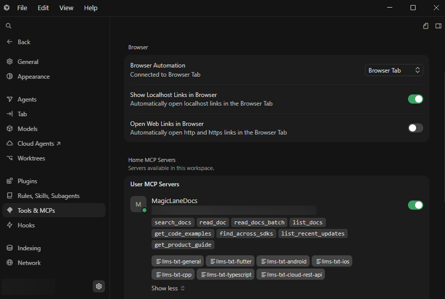

# Cursor AI Setup Guide

Connect the **Magic Lane MCP Docs Server** to Cursor so the AI can search and
read the Magic Lane developer documentation (Maps SDKs for Flutter, Android,
iOS, C++, TypeScript, and the Cloud REST APIs) while you code.

## Prerequisites

- [Cursor AI](https://cursor.com) installed (version 0.43 or later with MCP support)
- Node.js 22+ (`node --version`)
- No API key or account is required — the documentation this server exposes is public

## Building the Server Locally

### Option A: Using Node.js

From the repository root, build the server:

```bash
git clone https://github.com/magiclane/magiclane-mcp-docs-server.git
cd magiclane-mcp-docs-server
npm install
npm run build
```

The stdio entry point is produced at `dist/docs-server.esm.js`. Running the
TypeScript sources directly with `node src/docs-server.ts` does not work; use
the built bundle (or `npm run dev` while developing the server itself).

Find your Node.js path if you need an absolute command:

```bash
which node    # macOS / Linux
where node    # Windows
```

### Option B: Using Docker (HTTP transport)

The Docker image runs the **Streamable HTTP** entry point, so Cursor connects
to it by URL instead of spawning a process:

```bash
npm run docker:build   # docker build, with the version, revision and build-time labels filled in
docker run --rm -p 127.0.0.1:3000:3000 magiclane-mcp-docs-server
```

Then use configuration Option B below. See
[`http-server-setup.md`](https://github.com/magiclane/magiclane-mcp-docs-server/blob/HEAD/docs/http-server-setup.md) for the environment variables
and limits of the HTTP transport.

## 1. Access Cursor MCP Settings

Cursor integrates MCP servers through its settings interface. To configure:

1. **Open Cursor Settings**:
   - Press `Ctrl+Shift+J` (Windows/Linux) or `Cmd+Shift+J` (macOS)
   - Or click on the gear icon in the top-right corner and select "Cursor Settings"

2. **Navigate to MCP Configuration**:
   - In the settings panel, look for "Tools & MCP" or "Model Context Protocol" section
   - Alternatively, search for "MCP" in the settings search bar

3. **Edit MCP Configuration**:
   - Click "New MCP Server" / "Add Custom MCP" or similar button to open the configuration file
   - This will open `.cursor/mcp.json` in your workspace or global settings directory

## 2. Configure the Server

Create or edit your MCP configuration file (`.cursor/mcp.json` in your
workspace or the global location). Cursor uses the `mcpServers` key (not the
`servers` key that VS Code uses).

### Option A: Local build (recommended)

```json
{
  "mcpServers": {
    "magiclane-docs": {
      "command": "node",
      "args": ["/absolute/path/to/magiclane-mcp-docs-server/dist/docs-server.esm.js"]
    }
  }
}
```

Once the package is installed globally, the `magiclane-mcp-docs` command can
replace `node` plus the path:

```json
{
  "mcpServers": {
    "magiclane-docs": {
      "command": "magiclane-mcp-docs"
    }
  }
}
```

### Option B: HTTP server (Docker or a shared instance)

With the server running over HTTP (the Docker image above, or
`npm run start:http`):

```json
{
  "mcpServers": {
    "magiclane-docs": {
      "url": "http://127.0.0.1:3000/mcp"
    }
  }
}
```

## 3. Verify Configuration

1. **Update Path**: for Option A, use the full absolute path to your built `docs-server.esm.js` file
   - On Windows, use double backslashes (`\\`) or forward slashes (`/`) in paths
   - On macOS/Linux, use standard forward slashes (`/`)
2. **Save File**: save the configuration file
3. **Reload Cursor**: reload the Cursor window or restart the application
   - Press `Ctrl+Shift+P` (Windows/Linux) or `Cmd+Shift+P` (macOS)
   - Type "Reload Window" and press Enter

## 4. Test Integration

Once Cursor reloads, test the integration:

1. **Navigate to MCP Configuration**: Settings → "Tools & MCP" or "Model Context Protocol". The
   `magiclane-docs` entry should list eight tools (`search_docs`, `read_doc`, `read_docs_batch`,
   `list_docs`, `get_code_examples`, `find_across_sdks`, `list_recent_updates`, `get_product_guide`).



2. **Open Cursor Chat**: press `Ctrl+L` or `Cmd+L` to open the AI chat panel
3. **Check MCP Status**: look for an MCP indicator or status icon in the chat interface
4. **Test a query**: ask a documentation question:
   ```
   Using the Magic Lane docs, how do I calculate a route in the Flutter SDK?
   ```
5. **Verify tool usage**: Cursor should call `search_docs`, then `read_doc` on
   a `developer.magiclane.com` page, and answer from it. Approve the tool calls
   once — they are read-only.

## Verbose logging

While diagnosing a connection, add `env` to the stdio entry; every tool
invocation is then logged to stderr, which Cursor shows in the server's output:

```json
{
  "mcpServers": {
    "magiclane-docs": {
      "command": "node",
      "args": ["/absolute/path/to/magiclane-mcp-docs-server/dist/docs-server.esm.js"],
      "env": { "VERBOSE": "true" }
    }
  }
}
```
