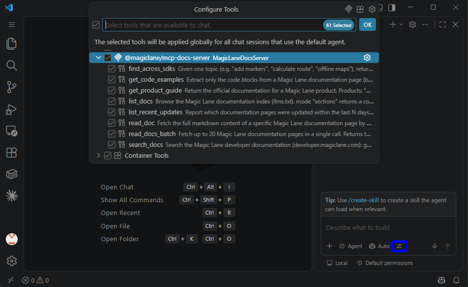

# VS Code Setup

Connect the **Magic Lane MCP Docs Server** to VS Code so the AI can search and
read the Magic Lane developer documentation. Two hosts are covered: **GitHub
Copilot** (agent mode) and **Claude** (the Claude Code extension). The server is
the same for both; only the configuration file and schema differ.

## Requirements

- VS Code 1.99+ with an MCP-capable client (e.g. GitHub Copilot Chat)
- Node.js 22+ installed on your system
- No API key or account required — the documentation this server exposes is public

Build the server from a clone of the repository:

```bash
git clone https://github.com/magiclane/magiclane-mcp-docs-server.git
cd magiclane-mcp-docs-server
npm install
npm run build        # produces dist/docs-server.esm.js (stdio) and dist/docs-server-http.esm.js (HTTP)

# note your absolute path to node, you will need it for the MCP config
# Mac/Linux
which node
# Example output: /usr/local/bin/node

# Windows
where node
# Example output: C:\Program Files\nodejs\node.exe
```

Or, once the package is published, install it globally — this provides the
`magiclane-mcp-docs` (stdio) and `magiclane-mcp-docs-http` (HTTP) commands:

```bash
npm install -g @magiclane/mcp-docs-server
```

Or run it as a container (HTTP transport):

```bash
npm run docker:build   # docker build, with the version, revision and build-time labels filled in
docker run --rm -p 127.0.0.1:3000:3000 magiclane-mcp-docs-server
```

## Development Environment

The project includes pre-configured VS Code settings for working on the server itself.

### Included Configurations

When you open the project in VS Code, you'll have access to:

- **`.vscode/launch.json`** - Debug configurations for running and testing
- **`.vscode/tasks.json`** - Build, test, and development tasks

### Launch Configurations

Access via the **Run and Debug** panel (`Ctrl+Shift+D` / `Cmd+Shift+D`) or press `F5`:

| Configuration                                         | Description                                                                                                                                       |
| ----------------------------------------------------- | ------------------------------------------------------------------------------------------------------------------------------------------------- |
| **Magic Lane: Start Dev Server**                      | `npm run dev` - the stdio server from sources with tsx (`VERBOSE=true`)                                                                           |
| **Magic Lane: Start HTTP Dev Server**                 | `npm run dev:http` - same, on the Streamable HTTP transport (`VERBOSE=true`)                                                                      |
| **Magic Lane: Start Production Server**               | Build, then `node --enable-source-maps dist/docs-server.esm.js` - the compiled stdio bundle                                                       |
| **Magic Lane: Start Production Server (HTTP)**        | Build, then `node --enable-source-maps dist/docs-server-http.esm.js` - the compiled HTTP bundle                                                   |
| **Magic Lane: Run Tests**                             | `npm run test` - the offline Vitest suite                                                                                                         |
| **Magic Lane: Run Tests (Watch)**                     | `npm run test:watch` - Vitest in watch mode for TDD                                                                                               |
| **Magic Lane: Debug Current Test File**               | `npx vitest run --no-file-parallelism <open file>` - Vitest on the test file open in the editor                                                   |
| **Magic Lane: Debug Integration Tests (needs build)** | Build, then `npx vitest run --no-file-parallelism test/integration.test.ts` - against the live site (sets `LIVE_DOCS_TESTS=1`; needs the network) |

Both dev-server configurations set `VERBOSE=true`, so every tool invocation is
logged to the debug console. Breakpoints bind inside the Vitest and npm child
processes because the configurations set `autoAttachChildProcesses`, and the
production configurations run with `--enable-source-maps`, so stack traces point
at the TypeScript sources rather than the bundle.

Note on the integration suite: `test/integration.test.ts` talks to the live
documentation site and only runs when `LIVE_DOCS_TESTS=1` is set in the
environment. The task runs `npm run test:live`, which sets the variable and
fails when `dist/` is missing; the launch configuration sets it in its `env`
block. The offline `npm test` never runs this suite.

### Available Tasks

Access via **Terminal > Run Task** or the Command Palette (`Ctrl+Shift+P` / `Cmd+Shift+P`) and click on **`Tasks: Run Task`**.

Use `Ctrl+Shift+B` / `Cmd+Shift+B` to run the default build task directly.

**Build Tasks:**

| Task                                       | Description                                                 |
| ------------------------------------------ | ----------------------------------------------------------- |
| Magic Lane: Start Dev Server               | `npm run dev` - stdio server from sources (default)         |
| Magic Lane: Start HTTP Dev Server          | `npm run dev:http` - HTTP transport                         |
| Magic Lane: Start Watch Server             | `npm run watch` - auto-reload on changes                    |
| Magic Lane: Build                          | `npm run build` - rollup bundles into dist/                 |
| Magic Lane: Type Check                     | `npm run type-check` - validate types only                  |
| Magic Lane: Clean                          | `npm run clean` - remove dist and coverage                  |
| Magic Lane: Start Production Server        | Build, then `npm start` - the compiled stdio server         |
| Magic Lane: Start Production Server (HTTP) | Build, then `npm run start:http` - the compiled HTTP server |

**Test Tasks:**

| Task                                      | Description                                                                                                                                                                                                     |
| ----------------------------------------- | --------------------------------------------------------------------------------------------------------------------------------------------------------------------------------------------------------------- |
| Magic Lane: Run Tests                     | `npm run test` - offline suite (default test task)                                                                                                                                                              |
| Magic Lane: Run Tests (Watch)             | `npm run test:watch` - tests with auto-reload                                                                                                                                                                   |
| Magic Lane: Run Tests (Coverage)          | `npm run test:coverage` - 100% thresholds                                                                                                                                                                       |
| Magic Lane: Run Integration Tests         | Build, then `npm run test:live` - `test/integration.test.ts` against the live documentation site                                                                                                                |
| Magic Lane: Lint                          | `npm run lint` - ESLint                                                                                                                                                                                         |
| Magic Lane: Lint Fix                      | `npm run lint:fix` - auto-fix ESLint issues                                                                                                                                                                     |
| Magic Lane: Lint Report File              | `npm run lint:report_file` - JSON lint report                                                                                                                                                                   |
| Magic Lane: Spellcheck                    | `npm run spellcheck` - spelling in .md and .ts files                                                                                                                                                            |
| Magic Lane: Check Manifest Tools          | `npm run check:manifest` - the manifest's `tools` match the tool classes                                                                                                                                        |
| Magic Lane: Validate MCP Manifest         | `npx --yes @anthropic-ai/mcpb@2.1.2 validate manifest.json` - schema check, mcpb pinned                                                                                                                         |
| Magic Lane: Audit Production Dependencies | `npm audit --omit=dev --audit-level=high`                                                                                                                                                                       |
| Magic Lane: Verify (all local gates)      | Runs Build, Type Check, Lint, Format Check, Spellcheck, Run Tests (Coverage), Check Manifest Tools, Validate MCP Manifest and Audit Production Dependencies in turn (there is no CI: these are the local gates) |

There is no CI: these checks run locally. `npm run check` builds, then runs
the static and test gates from the command line (type check, lint, format
check, spellcheck, `check:manifest`, coverage); the **Verify** task runs the
same and adds `mcpb validate` and the audit. `npm run release` (from a clean
git clone, with REUSE 6.2.0 at hand and the CHANGELOG entry dated today) runs
`check` (which builds first), then `reuse lint` and the audit, before packing.
`npm run check:manifest` (part of `npm run check`) additionally
checks that the `tools` array of `manifest.json` matches the tool classes;
`npm run sync:manifest` rewrites it.

**Other Tasks:**

| Task                             | Description                                    |
| -------------------------------- | ---------------------------------------------- |
| Magic Lane: Format               | `npm run format` - Prettier on all files       |
| Magic Lane: Format Check         | `npm run format:check` - check code formatting |
| Magic Lane: MCP Inspector        | `npm run inspect:dev`                          |
| Magic Lane: Install Dependencies | `npm install --ignore-scripts`                 |

## MCP Client Setup (GitHub Copilot)

Configure VS Code to use the Magic Lane MCP Docs Server as an AI tool provider.

### Find your VS Code MCP configuration file

**Method 1: Locate the mcp.json file** at the user-profile location:

**Windows:**

```
%APPDATA%\Code\User\mcp.json
```

**macOS:**

```
~/Library/Application Support/Code/User/mcp.json
```

**Linux:**

```
~/.config/Code/User/mcp.json
```

A workspace-level `.vscode/mcp.json` works the same way and can be committed
so teammates share the server.

**Method 2: Via Command Palette**

1. **Open Command Palette**: Press `Ctrl+Shift+P` (Windows/Linux) or `Cmd+Shift+P` (macOS)
2. **Type and select**: `MCP: Open User Configuration` (or `MCP: Add Server`)
3. VS Code opens its dedicated `mcp.json` file for MCP server configuration

VS Code uses the `servers` key with a `type` field (Cursor and Claude use
`mcpServers` without `type`).

### Node version (local build)

This runs the built bundle directly with Node.js:

```json
{
  "servers": {
    "magiclane-docs": {
      "type": "stdio",
      "command": "node",
      "args": ["/absolute/path/to/magiclane-mcp-docs-server/dist/docs-server.esm.js"]
    }
  }
}
```

Pointing `args` at `src/docs-server.ts` does **not** work (`ERR_MODULE_NOT_FOUND`):
the sources are TypeScript. Build first, or — for development of the server
itself — use `npm run dev` from a terminal.

### Installed command

Once the package is installed globally:

```json
{
  "servers": {
    "magiclane-docs": {
      "type": "stdio",
      "command": "magiclane-mcp-docs"
    }
  }
}
```

### HTTP Version (shared or containerized server)

The server also speaks Streamable HTTP, which is useful when one instance serves
several editors or runs in Docker. Start it with `npm run start:http` (or the
**Start Production Server (HTTP)** task, or the Docker container above), then:

```json
{
  "servers": {
    "magiclane-docs": {
      "type": "http",
      "url": "http://127.0.0.1:3000/mcp"
    }
  }
}
```

See [`http-server-setup.md`](./http-server-setup.md) for the environment
variables that govern the port, path, CORS policy, Host allowlist and trusted
proxies.

### Verbose logging

Add `env` to any stdio entry while diagnosing a problem — every tool invocation
is then logged to stderr, visible under **MCP: List Servers** → the server →
**Show Output**:

```json
{
  "servers": {
    "magiclane-docs": {
      "type": "stdio",
      "command": "node",
      "args": ["/absolute/path/to/magiclane-mcp-docs-server/dist/docs-server.esm.js"],
      "env": { "VERBOSE": "true" }
    }
  }
}
```

### Restart and verify

1. Save `mcp.json`.
2. `Ctrl+Shift+P` / `Cmd+Shift+P` → **Developer: Reload Window**.
3. Open Copilot Chat in **Agent** mode and check the tools picker — eight
   `magiclane-docs` tools should appear (`search_docs`,
   `read_doc`, `read_docs_batch`, `list_docs`,
   `get_code_examples`, `find_across_sdks`,
   `list_recent_updates`, `get_product_guide`).



4. Ask: _"Using the Magic Lane docs, how do I calculate a route in the Flutter SDK?"_
   Copilot should call `search_docs`, then `read_doc`, and answer with
   `developer.magiclane.com` URLs.

## Claude (Claude Code)

The [Claude Code](https://www.anthropic.com/claude-code) extension uses a different config key from Copilot — `mcpServers` rather than `servers` — and no `type` field.

### Option A: the CLI (recommended)

```bash
claude mcp add magiclane-docs -- node /absolute/path/to/magiclane-mcp-docs-server/dist/docs-server.esm.js
# or, with the package installed globally:
claude mcp add magiclane-docs -- magiclane-mcp-docs
```

`claude mcp list` should then show `magiclane-docs`.

### Option B: a project `.mcp.json`

Create `.mcp.json` in your project root (this file can be committed so teammates
share the server):

```json
{
  "mcpServers": {
    "magiclane-docs": {
      "command": "node",
      "args": ["/absolute/path/to/magiclane-mcp-docs-server/dist/docs-server.esm.js"]
    }
  }
}
```

Reload the window, then ask Claude _"Search the Magic Lane docs for offline maps
in the Android SDK"_ — it will call the tools after you approve them once.
